# CloudRAG - Cloud-Native Retrieval-Augmented Generation Platform

CloudRAG is a cloud-hosted Retrieval-Augmented Generation (RAG) application that allows users to interact with documents through natural-language questions.

The project combines a FastAPI backend, PostgreSQL with pgvector for vector storage, and an Ollama-hosted language model. It uses AWS infrastructure, Docker, Terraform, and GitHub Actions to automate deployment.

## Architecture

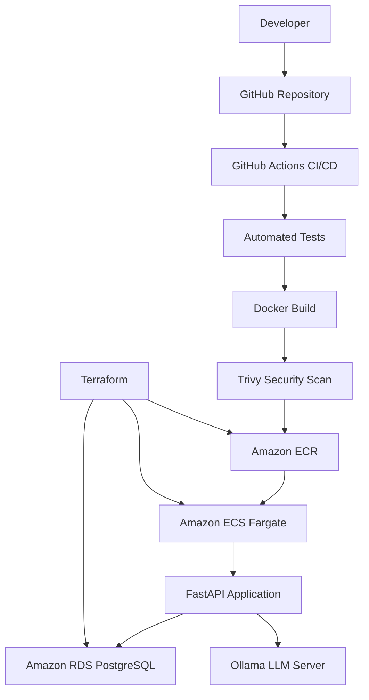

## Technology Stack

### Application
- Python 3.12
- FastAPI
- PostgreSQL
- pgvector
- Sentence Transformers
- Ollama
- Docker

### AWS and DevOps
- Amazon ECS with AWS Fargate
- Amazon ECR
- Amazon RDS for PostgreSQL
- AWS IAM
- AWS Secrets Manager
- AWS Systems Manager Session Manager
- Amazon CloudWatch Logs
- Terraform
- GitHub Actions
- Trivy

## Key Features

- Document ingestion and processing.
- Text chunking for document retrieval.
- Semantic embeddings using Sentence Transformers.
- Vector storage and similarity search with pgvector.
- Retrieval-Augmented Generation for question answering.
- FastAPI health and readiness endpoints.
- Containerized application deployment.
- Automated CI/CD with GitHub Actions.
- Container vulnerability scanning with Trivy.
- Infrastructure provisioning and management with Terraform.
- Database credentials managed through AWS Secrets Manager.

## CI/CD Pipeline

The GitHub Actions workflow automates the deployment process.

1. Checks out the repository.
2. Installs Python dependencies.
3. Runs automated tests.
4. Builds the Docker image.
5. Checks dependencies and scans the image for vulnerabilities.
6. Authenticates to AWS using OpenID Connect (OIDC).
7. Pushes the image to Amazon ECR.
8. Registers an updated Amazon ECS task definition.
9. Updates the ECS service.
10. Waits for the service to stabilize.

The deployment job runs on pushes to the `main` branch after the test-and-build job succeeds.

### CI/CD Workflow

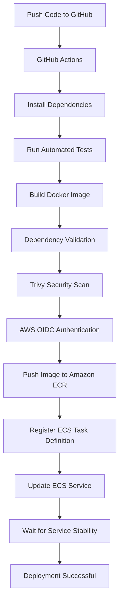

## AWS Deployment Architecture

The application runs as a container on Amazon ECS using AWS Fargate.

Amazon RDS for PostgreSQL stores document metadata and vector embeddings. The Ollama language model runs separately from the API container.

AWS Systems Manager Session Manager can be used to access the private application endpoint through port forwarding.

### AWS Components

| Component | Purpose |
|---|---|
| Amazon ECS Fargate | Runs the CloudRAG API container |
| Amazon ECR | Stores Docker images |
| Amazon RDS PostgreSQL | Stores document metadata and vector embeddings |
| pgvector | Enables vector similarity search |
| AWS Secrets Manager | Stores database credentials |
| AWS IAM | Controls access to AWS resources |
| GitHub Actions | Automates testing and deployment |
| AWS Systems Manager | Provides secure session and port-forwarding access |
| Amazon CloudWatch Logs | Stores application container logs |
| Terraform | Manages infrastructure as code |
| Ollama | Runs the language model used for answer generation |

## API Endpoints

The deployed application has been verified using the following endpoints.

| Endpoint | Purpose |
|---|---|
| `/health` | Checks application health |
| `/ready` | Checks application and database readiness |
| `/chat/ask` | Accepts questions and returns RAG-generated answers |
| `/docs` | Provides interactive FastAPI API documentation |

The `/chat/ask` endpoint was tested successfully against the deployed application.

## Screenshots and Deployment Evidence
The following screenshots document the CloudRAG CI/CD pipeline, AWS deployment, monitoring, API health checks, and Terraform validation.
### GitHub Actions CI/CD
| Screenshot | Description |
|---|---|
| 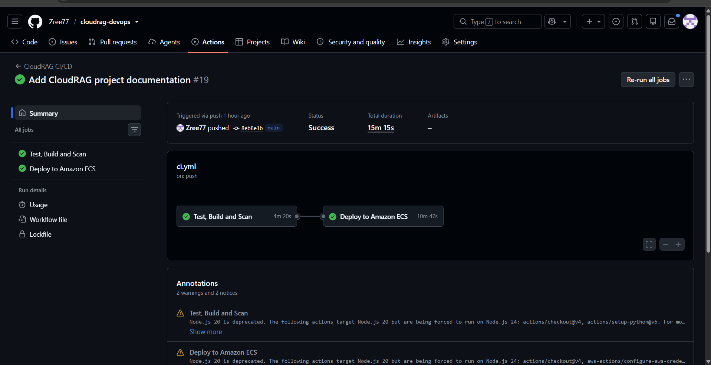 | Successful end-to-end CI/CD workflow |
| 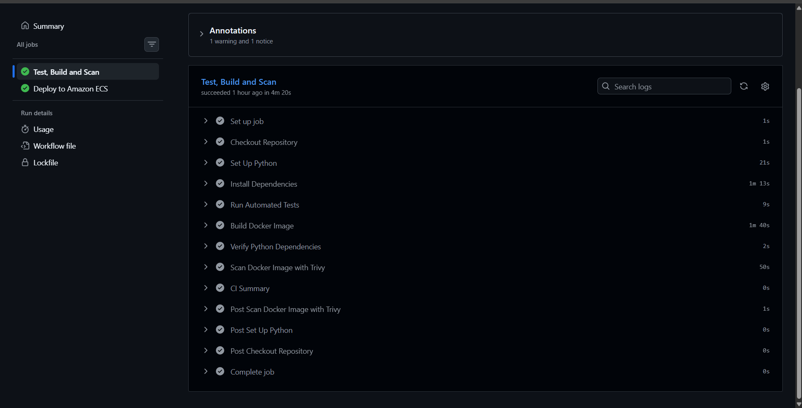 | Automated testing, Docker build, dependency verification, and Trivy security scanning |
| 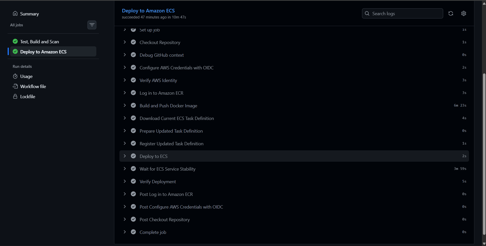 | AWS OIDC authentication, ECR image publishing, and ECS deployment verification |
### AWS ECS Deployment
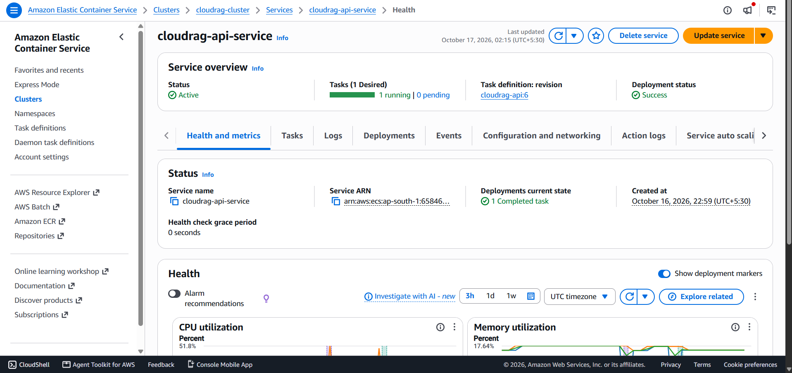
The ECS service was verified as active, with one running task and a successful deployment.
### CloudWatch Monitoring
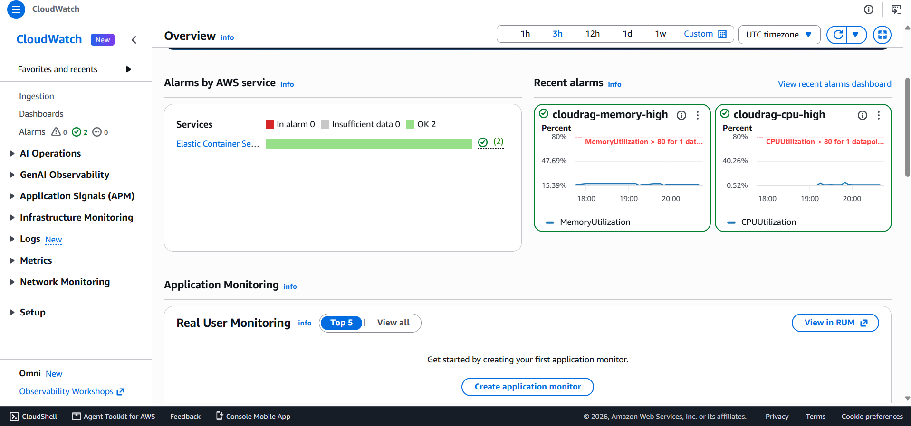
The CloudWatch dashboard displays ECS CPU utilization, memory utilization, and alarm status.
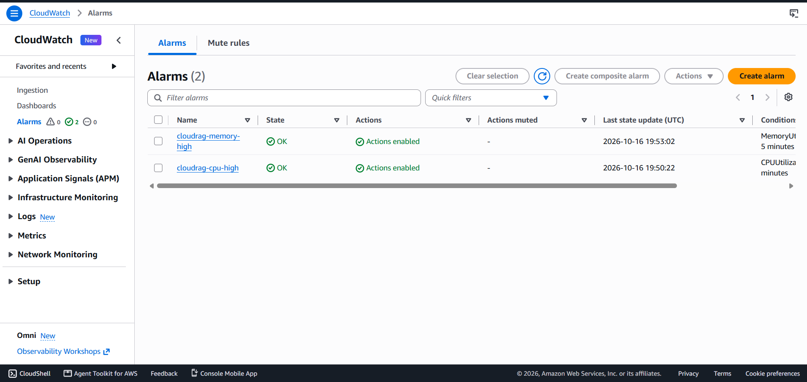
Both CPU and memory utilization alarms were configured with an 80% threshold and SNS alarm notifications. Both alarms were in the `OK` state during verification.
### API Health and Readiness
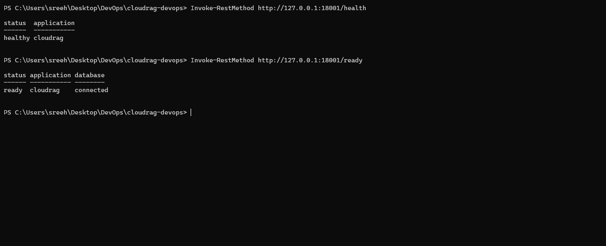
The deployed API was verified through AWS Systems Manager port forwarding:
- `/health` returned a healthy application status.
- `/ready` confirmed that the application was ready and the database was connected.
### Terraform Verification
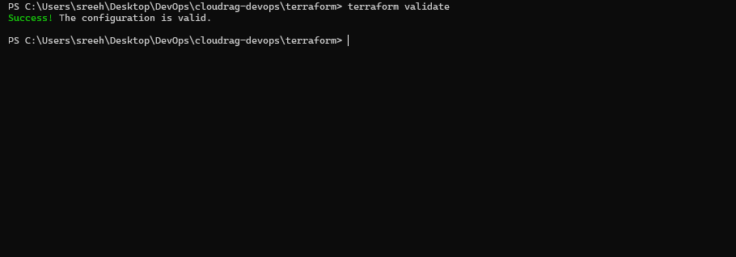
Terraform configuration validation completed successfully.
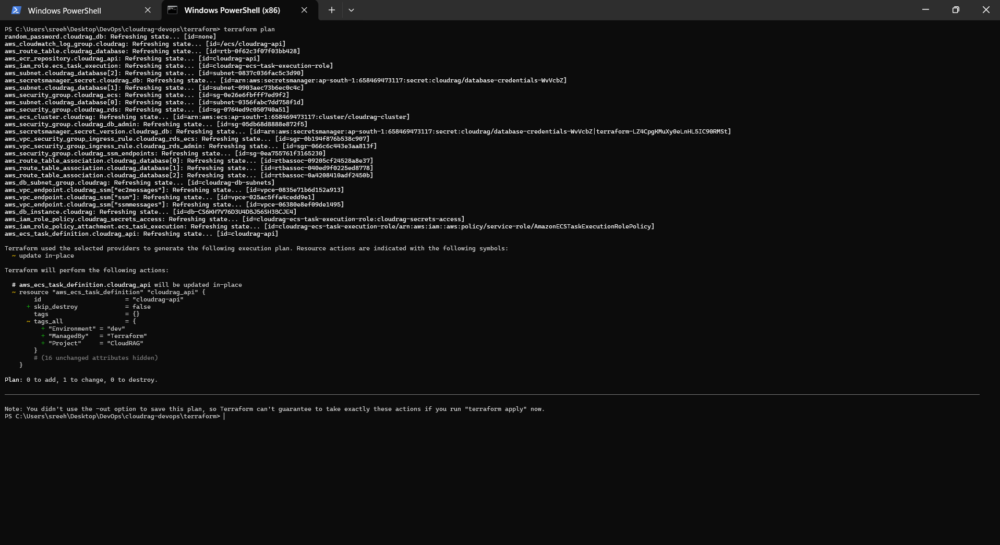
The reviewed Terraform plan proposed zero additions, one in-place change, and zero deletions. The plan was reviewed but not applied.
## Security Practices

- GitHub Actions authenticates to AWS using OpenID Connect (OIDC), avoiding long-lived AWS access keys in GitHub.
- IAM roles and policies control AWS access.
- Database credentials are stored in AWS Secrets Manager.
- The database is deployed without public access.
- The application is accessed through a controlled private networking path.
- Trivy scans the Docker image for vulnerabilities.
- Terraform state and secret files are excluded from Git tracking.
- The IAM trust policy restricts GitHub Actions access to the intended repository and deployment branch.

## Local Development

### Prerequisites

Install the following tools:

- Python 3.12
- Docker Desktop
- Docker Compose
- Git
- Ollama

### Setup

1. Clone the repository:

   ```bash
   git clone https://github.com/Zree77/cloudrag-devops.git
   ```

2. Navigate to the project directory:

   ```bash
   cd cloudrag-devops
   ```

3. Configure environment variables using the provided `.env.example` file. Never commit `.env` or actual credentials.

4. Start the required services using the project's Docker Compose configuration.

5. Ensure the configured Ollama model is available.

6. Open the FastAPI interactive documentation:

   ```text
   http://localhost:8000/docs
   ```

Refer to the project's configuration and Docker Compose files for the exact environment variables and service startup commands.

## Infrastructure as Code

Terraform configuration is maintained in the `terraform/` directory.

It manages selected AWS infrastructure components, including container deployment configuration, IAM permissions, networking, and database resources.

Terraform helps make infrastructure changes repeatable and maintainable.

Before applying infrastructure changes:

1. Review the Terraform configuration.
2. Run `terraform fmt`.
3. Run `terraform validate`.
4. Review the output of `terraform plan`.
5. Apply changes only after verifying the proposed actions.

Protect Terraform state because it may contain sensitive information.

## Testing and Deployment Verification

The project includes automated tests and deployment verification.

The following checks were performed after deployment:

- GitHub Actions CI/CD pipeline completed successfully.
- Amazon ECS reported the service as `ACTIVE`.
- The desired task count was one, with one task running.
- The deployed `cloudrag-api` container reported `HEALTHY`.
- The `/health` endpoint returned a healthy response.
- The `/ready` endpoint confirmed that the database was connected.
- The `/chat/ask` endpoint successfully returned an answer.

These checks verify that the deployed API, database connection, and RAG question-answering path are functioning.

## Challenges and Solutions

### GitHub Actions to AWS Authentication

**Challenge:** GitHub Actions initially failed to assume the AWS IAM deployment role.

**Solution:** Investigated AWS CloudTrail events and corrected the IAM role trust policy to match the GitHub OIDC subject identity.

### Container Deployment

**Challenge:** The latest application image needed to be deployed without manually replacing the running ECS task.

**Solution:** Automated Docker image publishing, ECS task-definition registration, and ECS service updates through GitHub Actions.

### Private Application Access

**Challenge:** The ECS API was not directly exposed to the public internet.

**Solution:** Used AWS Systems Manager port forwarding through an authorized administration instance to test the private application endpoint.

## Project Outcomes

- Built and deployed a cloud-hosted RAG application.
- Deployed a containerized API on Amazon ECS Fargate.
- Integrated Amazon ECR with GitHub Actions for automated deployment.
- Configured GitHub-to-AWS authentication using OIDC.
- Connected the application to Amazon RDS PostgreSQL with pgvector.
- Configured health checks and deployment verification.
- Implemented automated testing and container security scanning.
- Managed selected cloud infrastructure using Terraform.
- Verified application readiness, database connectivity, and RAG question answering after deployment.

## Future Improvements

- Add alerts for ECS task failures and application-level errors.
- Improve application-level logging and error monitoring.
- Add API authentication and request-rate limiting where appropriate.
- Add automated rollback and deployment notifications.
- Improve automated integration testing.
- Optimize language-model inference latency.
- Add dashboards for application and infrastructure metrics.

## Author

**Sreehari S.**

- GitHub: https://github.com/Zree77
- LinkedIn: https://linkedin.com/in/sreehari710

---

*CloudRAG is a learning and portfolio project demonstrating cloud application deployment, CI/CD automation, infrastructure as code, and Retrieval-Augmented Generation.*
